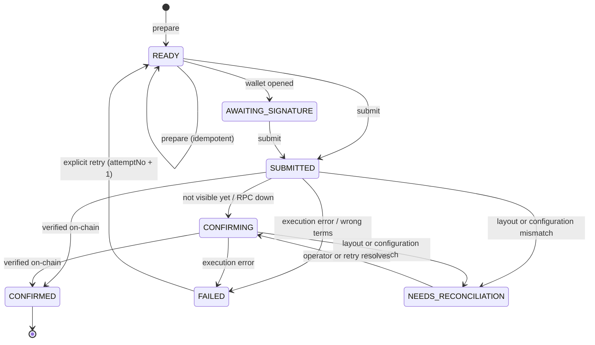
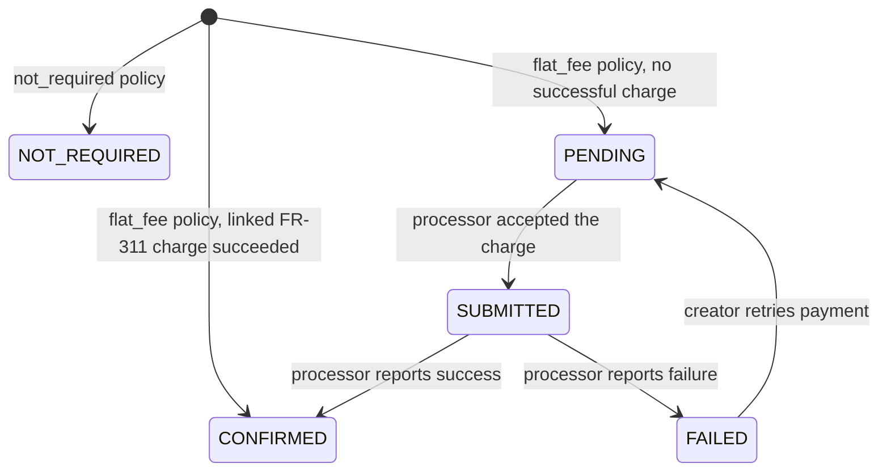
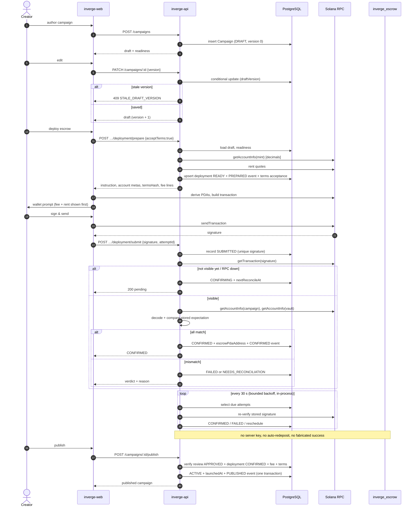

# Campaign drafts and escrow deployment

Status: **implemented against the programme source, not against a committed IDL or
a deployed binary.** Read [Open blockers](#open-blockers) before enabling this on
devnet or mainnet.

This document covers the creator's campaign draft, the escrow deployment attempt,
on-chain verification, reconciliation and publication. It is the contract between
`inverge-api`, `inverge-web` and `inverge-escrow`.

- Programme: `38rarxmrSL3rjCN2bwdDfQNLtpYRgLGp96xfkPXv39S1`
- Source of truth: `inverge-escrow/programs/inverge_escrow/src` (`lib.rs`, `state.rs`,
  `instructions/create_campaign.rs`, `constants.rs`)
- Routes: `/api/v1/campaigns`, `/api/v1/campaigns/:id/deployment/*`
- Tests: `src/modules/campaigns/deployment/*.spec.ts`, `test/campaign-deployment.e2e-spec.ts`

## 1. The three lifecycles

Campaign lifecycle, deployment lifecycle and fee lifecycle are separate state
machines. None is inferred from another, and no field duplicates another's value.

| Axis | Field | Owner | Terminal states |
|---|---|---|---|
| Campaign | `Campaign.status` (+ `reviewStatus`) | campaign review service | `FUNDED`, `FAILED`, `COMPLETED` |
| Escrow deployment | `CampaignDeployment.status` | deployment service | `CONFIRMED`, `FAILED` |
| Deployment fee | `CampaignDeployment.feeStatus` | fee reconciliation | `CONFIRMED`, `FAILED` |

A campaign may sit in `DRAFT` with a `CONFIRMED` deployment; a confirmed
deployment publishes nothing. `POST /campaigns/:id/publish` reads all three axes.

### 1.1 Deployment



Rules enforced in `deployment-state.ts`:

- `CONFIRMED` is terminal. Nothing auto-creates a second deployment.
- `FAILED` can only be retried by an explicit `prepare`; that increments
  `attemptNo` and clears the old signature/PDAs.
- `SUBMITTED` may never become `FAILED` without consulting the cluster.
- An RPC failure produces `CONFIRMING`/`NEEDS_RECONCILIATION`, never `FAILED`.
- An unknown signature (`getTransaction` returns null) is `CONFIRMING`.

### 1.2 Fee



`NOT_REQUIRED` satisfies publication but can never transition (there is no charge
to collect). A fee confirmation never confirms a deployment.

## 2. Data model

`CampaignDeployment` has **one row per campaign** (`campaignId @unique`). A retry
returns the same row; after a terminal `FAILED` it is reused with `attemptNo + 1`.
This is what makes "try again after a timeout" safe: a second row, a second rent
payment or a second signature cannot be created by accident.

| Column | Meaning |
|---|---|
| `status`, `attemptNo` | deployment lifecycle |
| `cluster`, `programId`, `commitment` | exact chain target this attempt was built for |
| `creatorWallet`, `tokenMint` | snapshot, so a later wallet change cannot rewrite the attempt |
| `campaignIdBytes` | hex of `sha256("inverge.campaign-id.v1:<campaign cuid>")` |
| `termsHash`, `termsVersion` | `sha256` over the canonical terms document |
| `instructionData` | base64 Anchor `create_campaign` data, built server-side |
| `expectedAccounts` | canonical account metas, expected values and derivation seeds |
| `txSignature` | `@unique` global idempotency key |
| `campaignPda`, `escrowVault`, `onChainState`, `verifiedAt` | written only after chain verification |
| `lastErrorCode`, `lastErrorMessage`, `nextReconcileAt`, `reconcileAttempts` | reconciliation bookkeeping |
| `feeStatus`, `feeMode`, `feeAmount`, `feeCurrency`, `feeChargeId`, `feeBreakdown` | fee lifecycle and the pre-signature disclosure |

`CampaignDeploymentEvent` is append-only: `PREPARED`, `SUBMITTED`,
`CONFIRMED`, `FAILED`, `NEEDS_RECONCILIATION`, `RECONCILE_REQUESTED`,
`FEE_CONFIRMED`, `FEE_FAILED`, `PUBLISHED`.

`CampaignTermsAcceptance` records `(campaign, termsVersion, termsHash, user)` when a
creator accepts the terms at prepare time. It is separate from the wallet signature.

## 3. Routes

All routes require a session bearer token and are owner-scoped. Autosave uses the
`dashboard` rate-limit policy; deployment and publication use `financial`
(fail-closed when Redis is unavailable).

### `POST /campaigns` (`201`)

Creates a persisted draft. Only authored content is accepted; unknown fields are
rejected by `forbidNonWhitelisted`, so a body cannot set `status`, `escrowPdaAddress`,
`termsHash`, `deployment`, `feeStatus` or a signature.

Required: `title`, `summary`, `location`, `problem`, `solution`, `beneficiaries`,
`targetAmount` (exact decimal string), `deadline` (ISO 8601, future),
`workingCapitalPercent` (exactly `20`, FR-503a), `objectionWindowDays`, and 2–6
`milestones` (`title`, `deliverable`, `allocationPercent`, `evidence`, optional
`expectedAt`). Milestone weights are shares of the amount left after the fixed
tranche, so they must total 100% on their own; readiness enforces that before
deployment.

Response: the draft plus `version` and a server-computed `readiness` object.

### `PATCH /campaigns/:id` (`200`)

Partial update. **`version` is required** and must equal the stored `draftVersion`;
a stale value returns `409 STALE_DRAFT_VERSION` with `currentVersion`. A successful
write increments the version. Editing is refused after a `CONFIRMED` deployment or
while the campaign is in review without a change request.

### `GET /campaigns/:id/draft` (`200`)

The authoritative draft, milestones, latest deployment projection and readiness.

### `POST /campaigns/:id/deployment/prepare` (`200`)

Body: `{ "acceptTerms": true }`.

1. Loads the owned draft and recomputes readiness. Any blocker → `400 CAMPAIGN_NOT_READY`
   with `checks` and `blockers`.
2. Refuses when no chain is configured → `503 CHAIN_NOT_CONFIGURED`. The draft is
   untouched.
3. Reads the settlement mint's `decimals` from the cluster and scales the target
   exactly (no float, no assumed exponent).
4. Computes the terms hash and campaign id, derives `floor = target`
   (All-or-Nothing), and encodes the instruction server-side.
5. Resolves the fee policy (see §5) and quotes rent.
6. Upserts the single deployment row, records `PREPARED`, records terms acceptance.

Response highlights:

```json
{
  "attemptId": "cuid",
  "attemptNo": 1,
  "status": "READY",
  "canSign": true,
  "cluster": "devnet",
  "commitment": "finalized",
  "programId": "38rarxmrSL3rjCN2bwdDfQNLtpYRgLGp96xfkPXv39S1",
  "creatorWallet": "…",
  "tokenMint": "…",
  "campaignIdBytes": "64 hex chars",
  "campaignPda": null,
  "escrowVault": null,
  "termsHash": "64 hex chars",
  "termsVersion": "inverge.campaign-terms.v1",
  "instruction": {
    "programId": "…",
    "dataBase64": "…",
    "accounts": [{ "name": "config", "writable": false, "signer": false }, "…"]
  },
  "fee": { "mode": "not_required", "status": "NOT_REQUIRED", "amount": null, "lines": ["…"] },
  "readiness": { "ready": true, "checks": ["…"], "blockers": [] }
}
```

The browser derives the three PDAs with the programme's fixed seeds and the
returned `campaignIdBytes`:

| Account | Seeds | Position in `accounts` |
|---|---|---|
| `config` | `["platform_config"]` | 0 |
| `campaign` | `["campaign", campaignIdBytes]` | 1 |
| `tokenMint` | — | 2 |
| `escrowVault` | `["escrow_vault", campaignPdaBytes]` | 3 |
| `creator` | wallet | 4 |
| `systemProgram` | — | 5 |
| `tokenProgram` | — | 6 |

`campaignPda` and `escrowVault` stay `null` until verification, because the server
does not accept a PDA the browser claims to have used.

### `POST /campaigns/:id/deployment/submit` (`200`)

Body: `{ "signature": "<base58>", "attemptId": "<optional>" }`.

- A different `attemptId` → `409 ATTEMPT_MISMATCH`.
- Another signature already recorded → `409 SIGNATURE_ALREADY_RECORDED`.
- A signature already used by another campaign → `409 SIGNATURE_ALREADY_USED`.
- Records `SUBMITTED` **and then verifies immediately**. It never reports success
  from the signature alone.
- RPC unavailability leaves the attempt `CONFIRMING` with
  `lastError.code = CHAIN_UNAVAILABLE`; the response is a `200` describing a pending
  attempt, not an error the client should treat as failure.

### `GET /campaigns/:id/deployment` (`200`)

Poll this route (no WebSockets). It returns `status`, `lastError`, `events`,
`explorerUrl`, `fee`, `onChainState`, `reconcileAttempts` and `pending`.

### `POST /campaigns/:id/deployment/reconcile` (`200`)

Re-runs verification for the stored signature. Safe to call repeatedly; writes are
derived from chain state, and a concurrent worker cannot regress a terminal state.

### `POST /campaigns/:id/publish` (`200`)

Publishes only when **all** hold: `status = IN_REVIEW`, `reviewStatus = APPROVED`,
`deployment.status = CONFIRMED`, a terms hash exists, ≥ 2 milestones, fee satisfied,
and `launchedAt` is null. Otherwise `400` with every blocker named. The update is a
conditional `updateMany` inside the same transaction as the `PUBLISHED` event.

## 4. Verification

`anchor-escrow.ts` encodes `create_campaign` and decodes the `Campaign` account from
the Rust source. `deployment-verification.ts` is pure and returns one of four
verdicts:

| Verdict | Meaning | Resulting status |
|---|---|---|
| `pending` | transaction or account not visible yet | `CONFIRMING` |
| `confirmed` | every argument and account matches | `CONFIRMED` |
| `failed` | execution error, wrong signer, wrong terms, wrong owner | `FAILED` |
| `needs_reconciliation` | right owner but layout/config does not match | `NEEDS_RECONCILIATION` |

Checks, in order:

1. The transaction exists and succeeded.
2. It contains a `create_campaign` instruction for the configured programme
   (`sha256("global:create_campaign")[0..8]` discriminator, Borsh arguments).
3. Instruction arguments equal the stored expectation: campaign id, target, floor,
   deadline, terms hash, working-capital bps, every milestone `(trancheBps,
   evidenceHash, deadline)`.
4. The instruction's creator meta equals the linked wallet.
5. The campaign account exists, is owned by the programme, decodes to the committed
   layout (867 bytes) and equals the stored expectation field by field.
6. The vault exists, is owned by the SPL token programme, and its mint and authority
   (the vault PDA itself) match.

A successful `getTransaction` alone never confirms anything: a transaction can be
valid and still be for different terms.

## 5. Fee policy

Proposed: **flat USD 10 equivalent**, *subject to product and contract
confirmation*. The current default is `not_required` because the escrow programme has
**no instruction that collects a platform fee**; charging one on-chain would require a
contract change, and charging one off-chain while implying it is escrowed would be a
misrepresentation.

`CAMPAIGN_DEPLOYMENT_FEE_MODE`:

- `not_required` (default) — `feeStatus = NOT_REQUIRED`, platform line `0.00`, marked
  `not_charged`. The FR-311 application fee remains a separate, earlier gate.
- `flat_fee` — requires `Campaign.applicationFeeChargeId` to point at a
  `SUCCEEDED`, `APPLICATION_FEE` `FlatFeeCharge` owned by the creator. The deployment
  links that rail; it does not invent a second charge. Missing → `409
  DEPLOYMENT_FEE_REQUIRED`; pending → `409 DEPLOYMENT_FEE_PENDING`; failed → `409
  DEPLOYMENT_FEE_INVALID`.

The response's `fee.lines` always separates:

| Line | Asset | Recipient | Meaning |
|---|---|---|---|
| `platform_fee` | USD | Inverge | charged or not charged, never silently converted |
| `network_fee` | SOL (lamports) | validators | base signature fee, estimate only |
| `account_rent` | SOL (lamports) | refundable while accounts exist | campaign account + vault |

No USD → SOL or USD → token conversion happens anywhere. If a fee must be paid in
SOL or in a token, the amount, asset, recipient and quote expiry must be shown before
authorisation; that is not implemented because no exchange-rate source or quote
lifetime has been agreed.

## 6. Reconciliation

- Deployment reconciliation runs on an in-process 30 s sweep
  (`PeriodicJobsService`), independent of Redis. Correctness does not depend on it
  because `POST …/reconcile` and `submit` run the same code.
- Each sweep examines at most 20 due attempts (`nextReconcileAt <= now`) in
  `SUBMITTED`, `CONFIRMING`, `NEEDS_RECONCILIATION`, and only those with
  `reconcileAttempts < 20`.
- Delay after the first submission: 30 s. Thereafter
  `min(30 s · 2^n, 30 min)` plus up to 5 s of jitter. `NEEDS_RECONCILIATION` uses a
  5-minute operator cadence.
- The RPC adapter (`src/ports/escrow/solana-rpc.adapter.ts`) retries transient
  failures up to 3 times with `250 ms · 2^n` plus jitter and a 10 s timeout. JSON-RPC
  error responses are not retried (they are deterministic).
- No worker sends a transaction, holds a key, or auto-redeploys. A timeout never
  triggers a second signature request.
- `OnChainEvent` (`FR-803`) is **not** written here; the indexer owns it.

## 7. Environment

| Variable | Default | Notes |
|---|---|---|
| `ESCROW_CHAIN_PROVIDER` | `disabled` | must be `solana-rpc` to deploy; disabled returns `503` |
| `SOLANA_RPC_URL` | — | required with the provider; never logged |
| `ESCROW_PROGRAM_ID` | `38rarx…39S1` | single-programme allowlist |
| `SOLANA_CLUSTER` | `devnet` | `mainnet-beta` requires `NODE_ENV=production` |
| `SOLANA_COMMITMENT` | `finalized` | `confirmed` allowed; finalized is safer for money |
| `SOLANA_TOKEN_MINTS` | — | JSON map `TokenType → mint` |
| `SOLANA_USDC_MINT` | per-cluster Circle mint | override only for a deliberate mint change |
| `CAMPAIGN_DEPLOYMENT_FEE_MODE` | `not_required` | `not_required` or `flat_fee` |
| `CAMPAIGN_DEPLOYMENT_FEE_USD` | `10` | disclosure only; no conversion |

There is **no** `FEE_PAYER_SECRET_KEY` use in this flow: the creator's wallet pays
and signs.

## 8. Security properties

- **Ownership** — every read/write compares `campaign.creatorId` (or
  `deployment.campaign.creatorId`) with the session user; others get `403`.
- **Server-derived trusted state** — status, cluster, programme id, mint, PDAs, terms
  hash, instruction bytes, fee state and signatures are never read from the request.
- **Money precision** — amounts are scaled from the mint's on-chain `decimals` with
  string arithmetic; no JSON float reaches the instruction.
- **Idempotency** — one row per campaign; one signature globally; conditional
  `updateMany` on `status` means a concurrent submit cannot be reset by a prepare.
- **No fabricated success** — an unconfigured chain returns `503`; an unreachable
  RPC leaves `CONFIRMING`; an unknown signature is `pending`.
- **Commitment** — verification reads at `SOLANA_COMMITMENT`, default `finalized`.
- **No custody** — the API never holds or uses a creator key.
- **Bounded work** — the sweeper and the RPC retries are both capped; a permanently
  broken attempt waits for an operator.

## 9. Error codes

| Code | HTTP | Where |
|---|---|---|
| `STALE_DRAFT_VERSION` | 409 | `PATCH /campaigns/:id` |
| `CAMPAIGN_NOT_READY` | 400 | prepare |
| `TERMS_NOT_ACCEPTED` | 400 | prepare |
| `CHAIN_NOT_CONFIGURED` | 503 | prepare, submit, verify |
| `CHAIN_UNAVAILABLE` | 503 / pending `200` | submit, reconcile |
| `SETTLEMENT_MINT_NOT_FOUND` / `_UNSUPPORTED` / `_UNDECODABLE` | 409 | prepare |
| `DEPLOYMENT_FEE_REQUIRED` / `_PENDING` / `_INVALID` | 409 | prepare |
| `ATTEMPT_MISMATCH` | 409 | submit |
| `SIGNATURE_ALREADY_RECORDED` | 409 | submit |
| `SIGNATURE_ALREADY_USED` | 409 | submit |
| `DEPLOYMENT_NOT_READY` | 409 | submit |
| `NOTHING_TO_RECONCILE` | 409 | reconcile |
| `TRANSACTION_NOT_FOUND` | — | verification detail (`lastError`) |
| `ON_CHAIN_EXECUTION_FAILED` | — | verification detail |
| `TRANSACTION_DOES_NOT_MATCH_CAMPAIGN` | — | verification detail |
| `EXPECTED_INSTRUCTION_MISSING` | — | verification detail |
| `CREATOR_MISMATCH` | — | verification detail |
| `CAMPAIGN_ACCOUNT_NOT_VISIBLE` / `VAULT_ACCOUNT_NOT_VISIBLE` | — | verification detail |
| `CAMPAIGN_ACCOUNT_WRONG_OWNER` / `VAULT_WRONG_OWNER` | — | verification detail |
| `CAMPAIGN_ACCOUNT_UNDECODABLE` / `VAULT_UNDECODABLE` | — | verification detail |
| `ON_CHAIN_STATE_MISMATCH` / `VAULT_MISMATCH` | — | verification detail |
| `PROGRAM_CONFIGURATION_CHANGED` | — | verification detail (`NEEDS_RECONCILIATION`) |

## 10. Sequence



## 11. What is deliberately not implemented

- No API endpoint sends a transaction, signs, or pays for rent/rewards. `/platform/escrow`
  remains a read-only balance projection.
- No contribution, milestone claim, release or refund routes. Those are chain-owned and
  belong with the indexer (FR-803).
- No USD↔SOL or USD↔cNGN conversion, quote expiry or fee-in-SOL charging.
- No automatic redeploy after a failed/timeout attempt.
- No WebSocket/SSE progress; polling the deployment route is the contract.

## 12. Open blockers

1. **No committed IDL and no deployment evidence.** `Anchor.toml` only declares
   `[programs.localnet]`. The discriminator, argument order and `Campaign` layout in
   `anchor-escrow.ts` are derived from Rust source. If the deployed binary differs,
   verification returns `NEEDS_RECONCILIATION`/`FAILED` rather than confirming, but the
   programme must still be confirmed against a real deployment before enabling.
2. **PDA derivation is client-side.** `campaignPda`/`escrowVault` are recorded only
   after verification. The server does not derive them offline, so a mismatch between
   the client's derivation and the programme would surface as a failed/absent account
   rather than a pre-signature error.
3. **Fee policy unconfirmed** — $10, asset, recipient, refundability, quote lifetime and
   atomicity with escrow creation.
4. **USDC-only settlement.** cNGN needs a confirmed mint, decimals and a documented
   conversion policy; readiness blocks it until then.
5. **`termsHash` and `campaignId` derivations are versioned assumptions**
   (`inverge.campaign-terms.v1`, `inverge.campaign-id.v1`). They are stable, but the
   programme/backers must accept them as the canonical document.
6. **Working-capital base is fixed (web D-045).** The programme computes the initial
   tranche as `targetAmount × 2_000 / 10_000`, so it does not grow with overfunding.
   Milestone weights total 10,000 on their own and divide
   `total_raised − initialTranche`; the last milestone absorbs the integer remainder.
   The surplus above target stays in escrow and is released only through that plan.
   Readiness requires exactly 20% working capital and a milestone total of 10,000.
   The earlier open question — whether an overfunded raise scales every tranche — is
   closed for this iteration. The contract is still not deployed, so none of this is
   live.
7. **Rent/fee estimates** are quotes. Only the wallet shows the final cost.

## 13. Verification checklist before enabling

1. Build `inverge-escrow`, run its tests, deploy to devnet, and record the programme id
   and a confirmed `create_campaign` signature.
2. Decode that transaction with `anchor-escrow.ts`; `decodeCreateCampaignInstruction`
   must return the expected arguments and `decodeCampaignAccount` the expected state.
3. Set `ESCROW_CHAIN_PROVIDER=solana-rpc`, `SOLANA_RPC_URL=<devnet>`,
   `SOLANA_CLUSTER=devnet`, `SOLANA_COMMITMENT=finalized`.
4. Run the e2e suite with the fake chain, then one real devnet deployment through the
   web flow.
5. Confirm with product/contract whether `CAMPAIGN_DEPLOYMENT_FEE_MODE` stays
   `not_required`; changing it is a config flip, not a code change.
